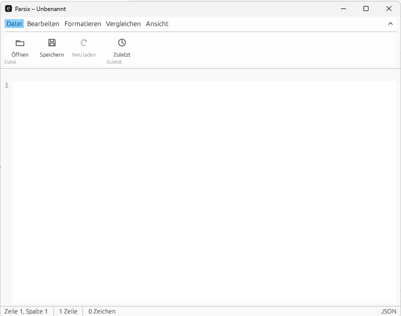

# Parsix

**Parsix** ist ein kompakter Editor und Formatierer für strukturierte Datenformate. Die Anwendung ermöglicht das Bearbeiten, Formatieren und Überprüfen von JSON-, XML- und YAML-Dateien in einer übersichtlichen Desktop-Oberfläche.

Der Fokus liegt auf einer einfachen Bedienung, einer direkten Bearbeitung der Inhalte und einer schnellen Formatierung ohne unnötige Zusatzfunktionen.

## Funktionen

### Oberfläche (Ribbon)

Die Bedienung erfolgt über ein an Office-Anwendungen angelehntes Ribbon am oberen Fensterrand. Die Funktionen sind in Registerkarten und thematische Gruppen gegliedert:

- **Datei** – Öffnen, Speichern, Neu laden (nur bei geöffneter Datei aktiv) und Zuletzt (zuletzt verwendete Dateien).
- **Bearbeiten** – Rückgängig und Wiederholen sowie Suchen und Ersetzen.
- **Formatieren** – Zielformat (JSON, XML, YAML), Formatieren, Minify-Schnellumschalter, Profile, Konvertieren in ein anderes Format sowie – nur bei JSON – die Schlüsselsortierung.
- **Ansicht** – Ribbon einklappen, Statusleiste ein- oder ausblenden und Zoom (60 % bis 300 %, Zurücksetzen auf 100 %).

Jede Gruppe trägt eine Beschriftung; die Knöpfe zeigen ein gezeichnetes Symbol über dem Namen. Ein Klick auf die bereits aktive Registerkarte oder der Pfeil oben rechts klappt das Ribbon ein, die Registerkarten bleiben sichtbar. Bei schmalen Fenstern brechen die Gruppen in weitere Zeilen um, sodass keine Bedienelemente abgeschnitten werden; der Editor nutzt den verbleibenden Platz vollständig.

### Darstellung und Einstellungen

Über die Registerkarte *Ansicht* → **Darstellung** öffnet sich der Einstellungsdialog:

- **Farbschema** – System, Hell oder Dunkel; die Wahl wird gespeichert.
- **Schriftgröße** – 9 bis 28 pt für den Editor (inklusive Zeilennummern).
- **Schriftart** – Standardschrift oder eine gefundene Systemschrift (unter Windows z. B. Consolas, Cascadia Mono, Lucida Console, Courier New).

Die Einstellungen werden sofort übernommen und unter `%APPDATA%\parsix\settings.json` (bzw. `$XDG_CONFIG_HOME/parsix/settings.json`) gespeichert.

### Unterstützte Formate

Parsix unterstützt derzeit drei weit verbreitete Datenformate:

- **JSON** – Parsen und automatische Formatierung mit einheitlicher Einrückung.
- **XML** – Strukturierte Formatierung mit einheitlicher Einrückung.
- **YAML** – Quelltexterhaltende Formatierung: Kommentare, Leerzeilen, Anker, Aliase, mehrzeilige Zeichenketten und Block-Skalare bleiben erhalten; nur die Einrückung wird normalisiert.

Das gewünschte Format kann direkt in der Oberfläche ausgewählt werden.

### Formatierung

Die Formatierung lässt sich über den Knopf **Profile…** auf der Registerkarte *Formatieren* an die eigenen Bedürfnisse anpassen:

- **Einrückung** – 2 Leerzeichen, 4 Leerzeichen oder Tabs.
- **Kompakte Darstellung (Minify)** – JSON und XML werden ohne Leerraum auf eine Zeile gebracht; bei YAML entfallen Leerzeilen, Kommentare und Inline-Kommentare, und die Einrückung wird auf ein Leerzeichen pro Ebene reduziert. Block-Skalare und mehrzeilige Zeichenketten bleiben inhaltlich unverändert.
- **JSON-Schlüssel sortieren** – sortiert die Schlüssel aller Objekte rekursiv alphabetisch. Ohne diese Option bleibt die ursprüngliche Reihenfolge erhalten.
- **Formatierungsprofile** – Kombinationen aus Einrückung, Minify und Sortierung lassen sich unter einem eigenen Namen speichern, auswählen und wieder löschen. Die Profile werden unter `%APPDATA%\parsix\profiles.json` (bzw. `$XDG_CONFIG_HOME/parsix/profiles.json`) abgelegt.

Alle Ausgaben enden einheitlich mit genau einem Zeilenumbruch. YAML erlaubt keine Tabs zur Einrückung; bei Auswahl von *Tabs* rückt Parsix YAML daher mit Leerzeichen ein (zwei pro Ebene, im Minify-Modus eines).

### Konvertierung

Über den Knopf **Konvertieren** auf der Registerkarte *Formatieren* wird das aktuelle Dokument in eines der anderen Formate umgewandelt (JSON ↔ XML ↔ YAML). Das Quelldokument wird zuvor auf gültige Syntax geprüft; Fehler werden wie beim Formatieren mit Zeilen- und Spaltenangabe gemeldet.

Das Ergebnis kann

- direkt in den Editor übernommen werden (inklusive Rückgängig-Schritt),
- als neue Datei gespeichert werden,
- optional als Vorher-/Nachher-Vergleich angezeigt werden.

Einrückung und Minify folgen dem aktiven Formatierungsprofil.

Da XML Attribute, Namensräume und Textknoten kennt, JSON und YAML aber nicht, gilt für die Abbildung:

- Das Wurzelelement wird zum einzigen Schlüssel auf oberster Ebene (`<root>…</root>` → `{"root": …}`).
- Attribute heißen `@name` (`id="1"` → `"@id": "1"`), der Textinhalt eines Elements liegt unter `#text`.
- Mehrfach vorkommende Kinderelemente werden zu einer Liste.
- Namensraumpräfixe bleiben im Elementnamen (`ns:tag`); `xmlns`-Deklarationen sind gewöhnliche Attribute.
- Kommentare, Verarbeitungsanweisungen und die XML-Deklaration gehen verloren; bei gemischtem Inhalt geht dessen Reihenfolge verloren.

YAML-Anker und Aliase werden beim Einlesen aufgelöst; die Zielformate kennen kein Äquivalent dazu. Komplexe YAML-Schlüssel (Folgen oder Abbildungen als Schlüssel) sind nicht darstellbar und werden als Fehler gemeldet.

### Editor

Der integrierte Editor bietet grundlegende Funktionen zur Bearbeitung von Dateien:

- Mehrzeiliger Texteditor
- Monospace-Schrift für übersichtliche Darstellung
- Syntax-Hervorhebung für JSON, XML und YAML (Schlüssel, Werte, Zahlen, Kommentare, Tags)
- Automatische Einrückung beim Zeilenumbruch (Klammern, Tags, YAML-Blöcke)
- Klammer- und Tag-Vervollständigung, Überspringen vorhandener schließender Zeichen
- Zeilen markieren, kopieren und nach oben/unten verschieben
- Zeilennummern
- Direkte Bearbeitung des Inhalts
- Rückgängig und Wiederholen (auch für Formatieren und Ersetzen)
- Automatische Erkennung des Dateiformats anhand der Dateiendung beim Öffnen

### Statusleiste

Die Statusleiste am unteren Fensterrand zeigt laufend:

- Zeile und Spalte der Cursorposition
- Anzahl der Zeilen und Zeichen
- das aktive Format (JSON, XML oder YAML)
- ob ungespeicherte Änderungen vorliegen

### Suchen und Ersetzen

- Suche nach Textstellen, wahlweise mit Beachtung der Groß-/Kleinschreibung
- Suche nach ganzen Wörtern
- Suche mit regulären Ausdrücken (inkl. Rückverweisen wie `$1` beim Ersetzen)
- Navigation zum nächsten und vorherigen Treffer
- Gleichzeitige Hervorhebung aller Treffer, der aktuelle Treffer kräftiger
- Anzeige der Anzahl gefundener Treffer
- Ersetzen einzelner Treffer
- Globales Ersetzen aller Treffer

Die Suche kann über `Ctrl + F` geöffnet werden. Die Optionen `Aa` (Groß-/Kleinschreibung), `Wort` (ganze Wörter) und `Regex` (reguläre Ausdrücke) lassen sich direkt in der Suchleiste umschalten. Bei einem ungültigen regulären Ausdruck erscheint ein entsprechender Hinweis.

### Fehlererkennung

Beim Formatieren werden die Inhalte auf syntaktische Fehler überprüft.

- Anzeige einer entsprechenden Fehlermeldung
- Ermittlung von Zeile und Spalte, sofern vom Parser verfügbar
- Farbige Hervorhebung der betreffenden Zeile und Markierung der genauen Fehlerspalte
- Automatisches Springen zur Fehlerposition, Cursor steht an der Fehlerstelle

### Dateioperationen

- Dateien öffnen
- Vorhandene Dateien speichern
- Neue Dateien über den Speichern-Dialog anlegen
- Automatische Formatauswahl anhand der Dateiendung
- Erkennung externer Änderungen an der geöffneten Datei mit Hinweis und Wahl zwischen *Neu laden*, *Behalten* und *Trotzdem speichern*
- Kennzeichnung ungespeicherter Änderungen im Fenstertitel
- Rückfrage beim Schließen mit ungespeicherten Änderungen
- Zuletzt verwendete Dateien (bis zu zehn) über die Registerkarte *Datei* → **Zuletzt**
- Dateien per Drag & Drop öffnen; bei ungespeicherten Änderungen wird vorher gefragt
- Automatische Wiederherstellung: Nicht gespeicherte Änderungen werden regelmäßig als Zwischenstand abgelegt und nach einem Absturz oder einem harten Beenden beim nächsten Start angeboten

Der Zwischenstand liegt unter `%APPDATA%\parsix\recovery.json` (bzw. `$XDG_CONFIG_HOME/parsix/recovery.json`) und wird nach dem Speichern oder bewussten Verwerfen entfernt.

## Tastenkombinationen

| Tastenkombination | Funktion |
|---|---|
| `Ctrl + O` | Datei öffnen |
| `Ctrl + S` | Datei speichern |
| `Ctrl + Z` | Rückgängig |
| `Ctrl + Umschalt + Z` / `Ctrl + Y` | Wiederholen |
| `Ctrl + F` | Suchen und Ersetzen |
| `Ctrl + L` | Aktuelle Zeile markieren |
| `Alt + ↑` / `Alt + ↓` | Markierte Zeilen nach oben/unten verschieben |
| `Ctrl + C` (ohne Auswahl) | Aktuelle Zeile kopieren |
| `Enter` | Nächsten Treffer suchen |
| `Esc` | Suchleiste schließen |

Unter macOS werden die entsprechenden Command-Tastenkombinationen verwendet.

## Technologie

Parsix wird mit Rust entwickelt.

Verwendete Bibliotheken:

- **eframe / egui** – Grafische Benutzeroberfläche und Editor
- **serde / serde_json** – JSON-Verarbeitung und Speicherung der Formatierungsprofile
- **serde_yaml_ng** – YAML-Verarbeitung
- **quick-xml** – XML-Verarbeitung
- **regex** – Reguläre Ausdrücke für die erweiterte Suche
- **rfd** – Native Datei-Dialoge

## Projektziel

Parsix soll ein unkompliziertes Werkzeug für die tägliche Arbeit mit strukturierten Datenformaten sein.

Anstatt für jede Formatierung einen Online-Dienst oder ein umfangreiches Entwicklungswerkzeug zu verwenden, bietet Parsix die wichtigsten Funktionen direkt auf dem Desktop.

Die Anwendung arbeitet lokal mit den geöffneten Dateien. Ein Upload zu einem externen Dienst ist nicht erforderlich.

Langfristig ist eine Web-Version vorgesehen.